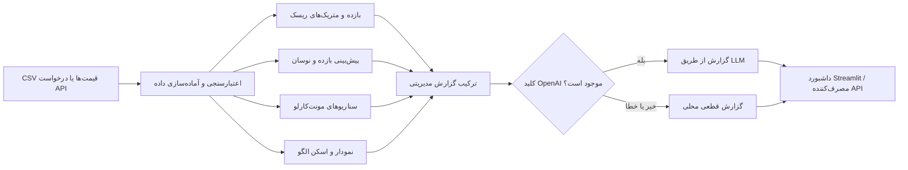

# Multimodal Risk Copilot

پلتفرم نمونه و قابل‌گسترش برای **تحلیل ریسک کمی و چندوجهی**: شاخص‌های تاریخی پرتفوی، سناریوهای مونت‌کارلو، پیش‌بینی سری زمانی، تحلیل نمودار و تولید یادداشت مدیریتی. این پروژه یک ابزار پشتیبان تحلیل است؛ خروجی آن توصیه سرمایه‌گذاری، قیمت‌گذاری رسمی، یا جایگزین اعتبارسنجی مستقل مدل و حاکمیت ریسک نیست.

## نمای کلی نهادی

این سامانه برای گردش‌کار تحلیلی تیم‌های سرمایه‌گذاری و ریسک طراحی شده است:

- **ریسک بازار و دنباله توزیع:** VaR و CVaR تاریخی در سطوح ۹۵٪ و ۹۹٪، VaR پارامتریک، نسبت‌های Sharpe/Sortino/Calmar، بازده سالانه‌شده و افت بیشینه.
- **سناریوسازی رو به جلو:** مسیرهای قیمت مبتنی بر حرکت براونی هندسی (GBM) یا پرش-پخش مِرتون (Merton jump-diffusion)، احتمال بازده منفی و خلاصه توزیع بازده نهایی.
- **سری زمانی:** بازده لگاریتمی، نوسان EWMA و پیش‌بینی بازده (AR(1)/Holt-Winters با fallback) و نوسان.
- **تحلیل نمودار:** رندر کندل/حجم، MACD و RSI و اسکن قواعدی الگوهای قیمت و سطوح حمایت/مقاومت. این سیگنال‌ها ابتکاری و قاعده‌محورند، نه خروجی مدل بینایی اعتبارسنجی‌شده.
- **جمع‌بندی مدیریتی:** عامل زبانی می‌تواند متریک‌ها و شواهد را به گزارش تبدیل کند. در نبود کلید API یا در صورت خطای سرویس، گزارش قطعی قاعده‌محور جایگزین می‌شود.
- **رابط‌ها:** داشبورد Streamlit و API مبتنی بر FastAPI.

## معماری و جریان داده



## تعریف‌های کمی

فرض کنید بازده‌های دوره‌ای ساده پرتفوی با $r_t$ نشان داده شوند و زیان برابر $L_t=-r_t$ باشد. برای سطح اطمینان $\alpha$:

$$\operatorname{VaR}_{\alpha}=Q_{\alpha}(L),\qquad
\operatorname{CVaR}_{\alpha}=\mathbb{E}[L\mid L\geq \operatorname{VaR}_{\alpha}].$$

در پیاده‌سازی، VaR/CVaR تاریخی با صدک نمونه زیان و میانگین زیان‌های واقع در دنباله محاسبه می‌شوند. تعریف CVaR در نمونه‌های گسسته/دارای تساوی ممکن است با روش‌های بهینه‌سازی متفاوت اندکی فرق کند.

بازده لگاریتمی و EWMA:

$$x_t=\ln(P_t/P_{t-1}),\qquad
\sigma_t^2=\lambda\sigma_{t-1}^2+(1-\lambda)x_{t-1}^2.$$

برای بازده میانگین $\bar r$، نرخ بدون ریسک سالانه $r_f$ و انحراف معیار نمونه $s$، نسبت Sharpe سالانه‌شده با ۲۵۲ روز معاملاتی:

$$\operatorname{Sharpe}=\sqrt{252}\,\frac{\bar r-r_f/252}{s}.$$

نسبت Sortino در این پروژه از انحراف معیار بازده‌های منفی به‌عنوان مخرج استفاده می‌کند؛ تعاریف متداول دیگر از هدف بازده/حداقل بازده قابل‌قبول بهره می‌برند. افت از اوج $W_t$:

$$\operatorname{DD}_t=\frac{W_t}{\max_{u\leq t}W_u}-1,\qquad
\operatorname{MDD}=\min_t\operatorname{DD}_t.$$

در GBM، برای گام زمانی $\Delta t=1/252$:

$$S_{t+\Delta t}=S_t\exp\left[(\mu-\tfrac12\sigma^2)\Delta t+\sigma\sqrt{\Delta t}\,Z_t\right],\qquad Z_t\sim\mathcal{N}(0,1).$$

مدل پرش-پخش به لگاریتم بازده پرش پواسون با شدت $\lambda_J$، میانگین اندازه لگاریتمی $m_J$ و انحراف معیار $s_J$ می‌افزاید و جمله جبرانی $\lambda_J(e^{m_J+s_J^2/2}-1)\Delta t$ را کسر می‌کند. پارامترهای مدل و فرض‌های همسان‌توزیعی/بازده ثابت باید پیش از استفاده واقعی بر مبنای دارایی و افق بازبینی شوند.

## ساختار مخزن

```text
multimodal-risk-copilot/
├── data/                    # داده و نمودار نمونه
├── src/
│   ├── app/                 # API و داشبورد
│   ├── llm_engine/          # گزارش مدیریتی و promptها
│   ├── risk/                # متریک‌ها و شبیه‌سازی
│   ├── time_series/         # آماده‌سازی و پیش‌بینی
│   └── vision/              # رندر نمودار و اسکن الگو
├── tests/                   # آزمون‌های واحد
├── .env.example
├── Dockerfile
├── docker-compose.yml
├── pyproject.toml
└── requirements.txt
```

## پیش‌نیازها

- Python نسخه **3.10 یا بالاتر** (Dockerfile بر پایه Python 3.11 است).
- Git برای دریافت/انتشار مخزن.
- دسترسی شبکه برای نصب وابستگی‌ها؛ استفاده از LLM اختیاری است و به `OPENAI_API_KEY` نیاز دارد.

## نصب و اجرای محلی

دستورها را از پوشه پروژه اجرا کنید:

```bash
cd multimodal-risk-copilot
python -m venv .venv
```

فعال‌سازی محیط مجازی:

```bash
# macOS / Linux
source .venv/bin/activate

# Windows PowerShell
.venv\Scripts\Activate.ps1
```

نصب بسته‌ها و اجرای آزمون‌ها:

```bash
python -m pip install --upgrade pip
pip install -r requirements.txt
python -m unittest discover tests
```

داشبورد در ترمینال اول:

```bash
streamlit run src/app/dashboard.py
```

API در ترمینال دوم:

```bash
uvicorn src.app.api:app --reload --host 127.0.0.1 --port 8000
```

نشانی‌های معمول: داشبورد `http://localhost:8501`، وضعیت API در `http://localhost:8000/health` و مستندات تعاملی API در `http://localhost:8000/docs`. داشبورد به‌طور پیش‌فرض از `data/sample_prices.csv` استفاده می‌کند و امکان بارگذاری CSV نیز دارد. برای ورودی خود ستون قیمت را از فهرست انتخاب کنید؛ داده باید عددی و قیمت‌ها مثبت باشند. نام ستون‌ها/حداقل طول لازم تابع endpoint و ماژول مورد استفاده است.

## تنظیم کلید LLM (اختیاری)

بدون کلید، محاسبات و گزارش قطعی همچنان کار می‌کنند. برای فعال‌سازی تکثیر گزارش از طریق OpenAI:

```bash
cp .env.example .env       # macOS / Linux
# Windows: Copy-Item .env.example .env
```

سپس `OPENAI_API_KEY` را فقط در فایل محلی `.env` قرار دهید. `.env` در `.gitignore` است. **کلید واقعی را در مخزن، کد، issue، اسکرین‌شات یا history گیت commit نکنید.** برای مخزن GitHub از Settings → Secrets and variables → Actions، کلید را به‌عنوان secret تعریف کنید و فقط در workflowهای مورد اعتماد مصرف کنید. پس از افشا، کلید را لغو و تعویض کنید. در اجرای مستقیم بدون Docker می‌توانید متغیر محیطی را در شِل تنظیم کنید.

## API مختصر

- `GET /health` — سلامت سرویس.
- `POST /analyze/metrics` — محاسبه ریسک و خروجی پیش‌بینی/مونت‌کارلو بر اساس آرایه `returns`.
- `POST /analyze/full` — تحلیل مجموعه داده بارگذاری‌شده؛ جزئیات قرارداد را در `/docs` ببینید.

نمونه درخواست برای metrics:

```bash
curl -X POST http://localhost:8000/analyze/metrics \
  -H 'Content-Type: application/json' \
  -d '{"returns":[0.01,-0.02,0.005,0.003,-0.01,0.007],"horizon_days":30,"n_paths":500,"model":"gbm"}'
```

برای محاسبات معنادار از آرایه بازده کافی و نماینده استفاده کنید؛ مثال کوتاه بالا صرفاً شکل درخواست را نشان می‌دهد، نه نمونه آماری معتبر. `/docs` منبع دقیق فیلدهای هر endpoint است.

## اجرا با Docker Compose

پس از نصب Docker Desktop/Engine و افزونه Compose:

```bash
cp .env.example .env   # در Windows فایل را کپی کنید
# در صورت نیاز، کلید اختیاری را در .env بنویسید
docker compose up --build
```

API روی `http://localhost:8000` و داشبورد روی `http://localhost:8501` در دسترس‌اند. توقف سرویس‌ها: `docker compose down`. فایل Compose برای بارگذاری متغیرهای محیطی، وجود `.env` را انتظار دارد؛ حتی اگر کلید نمی‌خواهید، فایل را از `.env.example` بسازید.

## انتشار مرحله‌به‌مرحله در GitHub

### روش پیشنهادی با ترمینال

مراحل زیر را به‌ترتیب انجام دهید؛ `<USERNAME>` و `<REPOSITORY>` را با نام حساب و مخزن خود جایگزین کنید.

1. در [github.com](https://github.com) وارد حساب شوید، از علامت **+** گزینه **New repository** (یا دکمه **New**) را انتخاب کنید؛ نامی مانند `multimodal-risk-copilot` وارد کنید، سطح دسترسی **Public** یا **Private** را برگزینید و روی **Create repository** بزنید. اگر پوشه محلی از قبل README/commit دارد، مخزن خالی (بدون README، license یا gitignore اولیه) بسازید تا تاریخچه‌ها تداخل نکنند.
2. در رایانه‌تان ترمینال/PowerShell را در پوشه پروژه باز کنید و آزمون‌ها را اجرا کنید: `python -m unittest discover tests`. فقط اگر همه آزمون‌ها موفق شدند ادامه دهید.
3. ترمینال را در پوشه پروژه باز کنید و وضعیت فایل‌ها را بازبینی کنید:
   ```bash
   cd multimodal-risk-copilot
   git status --short
   ```
4. مطمئن شوید `.env` و هر فایل دارای داده حساس در فهرست commit نیست. در صورت مشاهده کلید افشا‌شده، ابتدا آن را revoke/rotate کنید؛ پاک کردن فایل از commit جاری، آن را از history حذف نمی‌کند.
5. اگر مخزن محلی هنوز Git نشده است، مقداردهی اولیه و commit نخست را انجام دهید:
   ```bash
   git init
   git branch -M main
   git add .
   git status --short
   git commit -m "Initial commit: multimodal risk copilot"
   ```
6. در صفحه مخزن GitHub، دکمه **Code** را باز کرده و نشانی HTTPS مخزن خود را کپی کنید. آن را به‌جای `<YOUR-REPOSITORY-URL>` بگذارید:
   ```bash
   git remote add origin <YOUR-REPOSITORY-URL>
   git push -u origin main
   ```
   اگر `origin` از قبل تنظیم است: `git remote -v` را ببینید و در صورت نیاز `git remote set-url origin <YOUR-REPOSITORY-URL>` اجرا کنید. احراز هویت HTTPS معمولاً به GitHub CLI یا personal access token نیاز دارد؛ رمز حساب به‌عنوان رمز Git پذیرفته نمی‌شود.
7. صفحه GitHub را تازه کنید و بررسی کنید README و فایل‌های پروژه نمایش داده شوند. آزمون‌ها را پیش از انتشار با `python -m unittest discover tests` اجرا کنید.
8. برای تغییرات بعدی:
   ```bash
   git add <files>
   git commit -m "Describe the change"
   git push
   ```
   سپس در GitHub می‌توانید Pull Request، Issues و Releases را برای بازبینی/نسخه‌بندی به‌کار ببرید. پیش از عمومی‌کردن مخزن، مجوز داده‌ها و فایل‌های نمونه، مجوز نرم‌افزار و نبود secrets را بررسی کنید.

## آزمون‌ها و حدود استفاده

آزمون‌های `tests/` اجزای متریک ریسک، مونت‌کارلو و سری زمانی را بررسی می‌کنند. برای بازتولیدپذیری در شبیه‌سازی، seed تعیین کنید. آزمون واحد جایگزین آزمون انتهابه‌انتها، اعتبارسنجی خارج از نمونه، بک‌تست با هزینه معامله، آزمون تنش، بررسی سوگیری look-ahead، کالیبراسیون و بازبینی مستقل مدل نیست. پیش از کاربرد نهادی باید کیفیت/تداوم داده، تقویم معاملاتی، مقیاس‌بندی افق، پارامترها، ریسک نقدشوندگی/مبنایی، حدود اطمینان، کنترل دسترسی، ثبت رویداد، امنیت API و الزامات قانونی به‌طور جداگانه تعریف و تأیید شوند.

## مجوز

این پروژه تحت مجوز MIT ارائه شده است؛ متن شرایط در فایل `LICENSE` قرار دارد.
