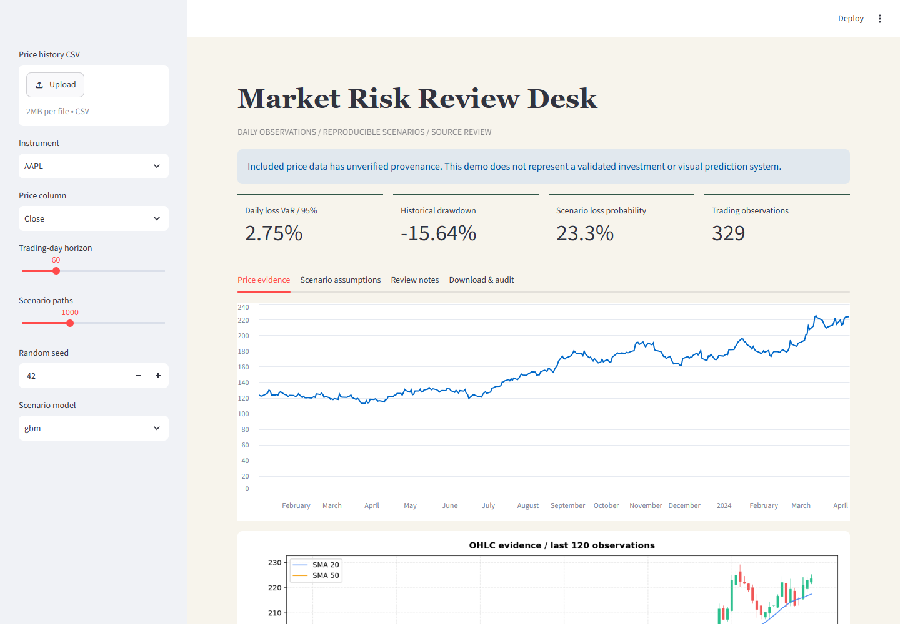

# Market Risk Review Desk

[](https://github.com/saintedwind/multimodal-risk-copilot/actions/workflows/validation.yml)

A quantitative engineering portfolio by **Peyman Gholamhosseini**: inspect daily risk statistics, reproducible scenarios and source assumptions.

این نسخه محاسبات ریسک، سناریوسازی و نمودارهای قابل بررسی را ارائه می‌کند. آزمون‌ها و محدودیت‌ها شفاف ثبت می‌شوند؛ ادعای پیش‌بینی سودآور یا بینایی اعتبارسنجی‌شده ندارد.



[Mobile capture](reports/desk-mobile.png) | [Verified tests and Docker execution](https://github.com/saintedwind/multimodal-risk-copilot/actions/runs/38410088772)

## Implemented

- Simple daily returns for risk metrics; correctly fitted log-return drift for GBM. Invalid/non-finite input is rejected; undefined ratios are null.
- Reproducible seeded GBM and Merton simulations, explicit jump assumptions, AR(1) baseline and correctly labeled EWMA.
- Separate instrument selection. The sample has 330 rows each for AAPL/SPY, with **unverified market provenance**.
- Numeric OHLC heuristics without calibrated confidence. Real image decoding/hash checks; **no visual inference model**. Image-only input yields no invented diagnosis.
- Shared FastAPI/Streamlit service; 2 MB CSV, 20,000 rows, ascending unique dates, two-million-path-day budget and two concurrent API analyses.
- Default deterministic notes; optional local model selects supplied observations, preserving exact numbers. Explicit fallback. **No paid API calls.**

## Employer walkthrough

Select one instrument, inspect daily VaR/drawdown, compare seeded scenario assumptions, then download the analysis JSON. Review [measured evidence](reports/validation.md): chronological AR(1) did **not** beat the zero-return baseline on either sample instrument. No predictive advantage is claimed.

## Run from the source checkout

Python 3.12+. Create/activate a virtual environment, then:

```sh
python -m pip install -e ".[dev]"
python -m pytest
python -m streamlit run src/app/dashboard.py --server.address 127.0.0.1 --browser.gatherUsageStats false
```

Dashboard: http://127.0.0.1:8501. In another terminal:

```sh
python -m uvicorn src.app.api:app --host 127.0.0.1 --port 8000
python -m scripts.live_check
```

API reference: http://127.0.0.1:8000/docs. `GET /analyze/sample?symbol=SPY`. `POST /analyze/metrics`: at least five finite daily simple returns greater than -1, horizon/path limits and seed. `POST /analyze/full`: multipart CSV, price_col and optional symbol; mixed instruments require selection. Close is required; Date/Symbol enable validation/selection. OHLC enables numeric heuristics. Without Date, supplied row order and daily frequency are assumed.

Optional isolated browser checks:

```sh
python -m pip install playwright==1.51.0
python -m playwright install chromium
python -m scripts.browser_check
```

Docker: `docker compose up --build`. Ports bind to loopback; no .env required. Sample data belongs to the checkout, not a standalone wheel.

## Optional local model

Start a structured-output-compatible llama.cpp server at **127.0.0.1:8081**. Set `REPORT_PROVIDER=local` in the shell before running the service or live checks. Fixed loopback endpoint, 64 output tokens, validated indices and explicit deterministic fallback. `.env.example` documents settings; the shell/container environment applies them. Measured CPU tests use official Qwen3-0.6B Q8_0 / llama.cpp b11476; weights are excluded. The model selects observations, not new forecasts.

## Conventions and limits

Loss is -r. VaR uses the [NumPy linear quantile](https://numpy.org/doc/stable/reference/generated/numpy.quantile.html); CVaR is the conditional sample mean above that loss threshold. Negative VaR is possible. Annualization assumes 252 trading observations; Sortino uses RMS shortfall below the effective daily risk-free rate. Zero denominators return null. EWMA forward variance is constant. Jump parameters are scenario assumptions.

Local single-process demonstration: no authentication, distributed queues, verified live feed, calibrated visual inference or portfolio weights. Software tests do not establish financial performance or institutional readiness. Data rights/provenance are unverified. MIT software license.
