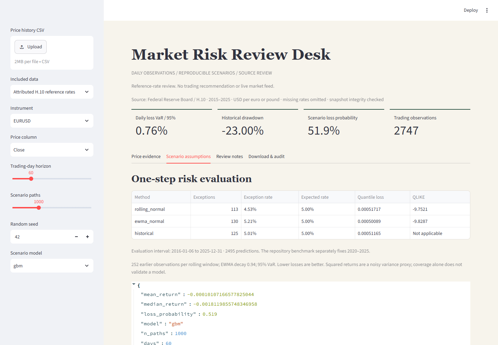

# Market Risk Review Desk

[](https://github.com/saintedwind/multimodal-risk-copilot/actions/workflows/validation.yml)

A quantitative engineering portfolio by **Peyman Gholamhosseini**: attributed reference-rate data, chronological volatility and tail-risk evaluation, reproducible scenarios and source assumptions.

این نسخه محاسبات ریسک، سناریوسازی و نمودارهای قابل بررسی را ارائه می‌کند. آزمون‌ها و محدودیت‌ها شفاف ثبت می‌شوند؛ ادعای پیش‌بینی سودآور یا بینایی اعتبارسنجی‌شده ندارد.


[Mobile capture](reports/desk-mobile.png) | [Verified tests and Docker execution](https://github.com/saintedwind/multimodal-risk-copilot/actions/runs/38410088772)

## Implemented

- Simple daily returns for risk metrics; correctly fitted log-return drift for GBM. Invalid/non-finite input is rejected; undefined ratios are null.
- Reproducible seeded GBM and Merton simulations, explicit jump assumptions, AR(1) baseline and correctly labeled EWMA.
- Default EURUSD/GBPUSD reference-rate snapshot: 2,748 observations each from 2015–2025, directly attributed to the Federal Reserve Board H.10 release. Hash-checked before loading. The optional legacy AAPL/SPY OHLC sample remains unverified.
- Numeric OHLC heuristics without calibrated confidence. Real image decoding/hash checks; **no visual inference model**. Image-only input yields no invented diagnosis.
- Shared FastAPI/Streamlit service; 2 MB CSV, 20,000 rows, ascending unique dates, two-million-path-day budget and two concurrent API analyses.
- Default deterministic notes; optional local model selects supplied observations, preserving exact numbers. Explicit fallback. **No paid API calls.**

## Employer walkthrough

Select an attributed reference pair, open Scenario assumptions, inspect the exception rates and loss scores, then download the full analysis and source manifest. The [2020–2025 risk benchmark](reports/risk-benchmark.md) compares fixed EWMA, rolling-normal and historical methods; every prediction and annual result is exported. EWMA's variance loss was lower than the rolling baseline for both pairs in aggregate and 11 of 12 pair/year slices. This is descriptive evidence on two correlated series, not proof of general superiority or trading performance. The separate legacy AR(1) development comparison did **not** beat simple return baselines.



## Run from the source checkout

Python 3.12+. Create/activate a virtual environment, then:

```sh
python -m pip install -e ".[dev]"
python -m pytest
python -m streamlit run src/app/dashboard.py --server.address 127.0.0.1 --browser.gatherUsageStats false
```

Dashboard: http://127.0.0.1:8501. In another terminal:

```sh
python -m uvicorn src.app.api:app --host 127.0.0.1 --port 8000
python -m scripts.live_check
```

API reference: http://127.0.0.1:8000/docs. `GET /analyze/reference?symbol=EURUSD` uses the attributed snapshot; `GET /analyze/sample?symbol=SPY` is the unverified legacy sample. `POST /analyze/metrics`: at least five finite daily simple returns greater than -1, horizon/path limits and seed. `POST /analyze/full`: multipart CSV, price_col and optional symbol; mixed instruments require selection. Close is the default price column; Date/Symbol enable validation/selection. Genuine OHLC enables numeric heuristics. Without Date, supplied row order and daily frequency are assumed.

Optional isolated browser checks:

```sh
python -m pip install playwright==1.51.0
python -m playwright install chromium
python -m scripts.browser_check
```

Docker: `docker compose up --build`. Ports bind to loopback; no .env required. Sample data belongs to the checkout, not a standalone wheel.

## Optional local model

Start a structured-output-compatible llama.cpp server at **127.0.0.1:8081**. Set `REPORT_PROVIDER=local` in the shell before running the service or live checks. Fixed loopback endpoint, 64 output tokens, validated indices and explicit deterministic fallback. `.env.example` documents settings; the shell/container environment applies them. Measured CPU tests use official Qwen3-0.6B Q8_0 / llama.cpp b11476; weights are excluded. The model selects observations, not new forecasts.

## Conventions and limits

Loss is -r. VaR uses the [NumPy linear quantile](https://numpy.org/doc/stable/reference/generated/numpy.quantile.html); CVaR is the conditional sample mean above that loss threshold. Negative VaR is possible. Annualization assumes 252 trading observations; Sortino uses RMS shortfall below the effective daily risk-free rate. Zero denominators return null. EWMA forward variance is constant. Jump parameters are scenario assumptions.

Local single-process demonstration: no authentication, distributed queues, live feed, calibrated visual inference or portfolio weights. Software tests do not establish financial performance or institutional readiness. MIT applies to software; attributed H.10 data is public domain under the Board's [reuse notice](https://www.federalreserve.gov/disclaimer.htm). Legacy OHLC data rights/provenance remain unverified.

## Reproduce the reference benchmark

Run `python -m scripts.risk_benchmark` offline against the checked-in snapshot. The evaluation interval is 2020–2025, using prior observations only, a 252-observation rolling window, EWMA decay 0.94, zero conditional mean and 95% VaR. Lower quantile loss and QLIKE are better. QLIKE uses squared daily returns as a noisy variance proxy, not intraday realized volatility. Coverage diagnostics include exact binomial p-values and transition counts; sparse-sample independence p-values require caution. Coverage non-rejection does not prove calibration.

[Source manifest](data/official_fx_manifest.json) records units, source URLs, retrieval time, raw-response digests and snapshot hash. [H.10 methodology](https://www.federalreserve.gov/releases/h10/about.htm) describes noon New York reference rates. These are not closing or executable quotes; the CSV's `Close` column is a compatibility field for the reference rate. ND rows are removed without filling; returns can span holiday gaps. No OHLC or volume is fabricated. No equity corporate actions apply to these exchange rates. This latest-vintage snapshot cannot reconstruct what was known at historical publication times. Refresh explicitly with `python -m scripts.import_official`; a refresh may change the frozen data and must be reviewed. The 2025 reporting slice is not an untouched holdout.

## Review improvements / 2026-10-13

The dashboard compares AR(1) with zero-return and expanding historical-mean baselines, using the last 100 eligible observations and at least 60 preceding returns. MAE and RMSE are exported with the underlying predictions. This is a development comparison, not an untouched research holdout or proof of investment performance. Short histories explicitly skip evaluation.

Each result includes a versioned audit record and SHA-256 of the little-endian float64 return vector. This identifies the numeric input, not the original file or its provenance. Dated uploads require ascending dates with at most one row per calendar day; missing trading days are not filled and exchange calendars are not validated. Indicators use the entire supplied history before displaying the latest 120 observations. Volume is excluded from the price selector.
